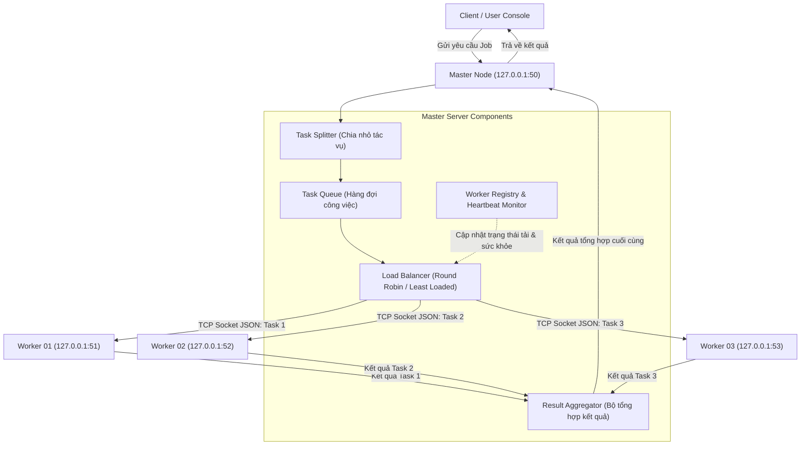

# Hệ Thống Tính Toán Phân Tán & Cân Bằng Tải (Master - Worker Architecture)

Hệ thống tính toán phân tán (Distributed Computing) và cân bằng tải công việc (Load Balancing) theo kiến trúc **Master - Worker** được phát triển bằng **Java 21+**.

Hệ thống sử dụng mô hình đa cổng (Multi-port Local Nodes) với **1 Master** và **3 Workers**:
- **Master Node**: Lắng nghe tại `127.0.0.1:50`
- **Worker 01 (Client 01)**: Lắng nghe tại `127.0.0.1:51`
- **Worker 02 (Client 02)**: Lắng nghe tại `127.0.0.1:52`
- **Worker 03 (Client 03)**: Lắng nghe tại `127.0.0.1:53`

---

## 1. Sơ Đồ Kiến Trúc Hệ Thống (Topology & Data Flow)



---

## 2. Các Bài Toán & Thuật Toán Tính Toán Song Song Đã Hiện Thực

### A. Ví dụ khởi đầu (Arithmetic Expression DAG)
- **Bài toán**: Tính biểu thức song song $(1 + 2) + (3 \times 2)$.
- **Phân chia**:
  - `Task 1` ("1+2") được gửi tới `Worker 01` (Port 51) $\rightarrow$ Trả về `3`.
  - `Task 2` ("3*2") được gửi tới `Worker 02` (Port 52) $\rightarrow$ Trả về `6`.
- **Tổng hợp**: Master tổng hợp $3 + 6 = \mathbf{9}$.

### B. Tính toán Ma trận Phân tán (Distributed Matrix Engine)
- **Cộng & Trừ ma trận ($A \pm B$)**: Phân chia theo dải dòng (Row Striping). Mỗi Worker nhận $\frac{Rows}{K}$ dòng tương ứng của $A$ và $B$, tính tổng/hiệu cục bộ và gửi về lát cắt dòng. Master ghép nối các lát cắt thành ma trận hoàn chỉnh.
- **Nhân 2 ma trận ($A \times B$)**: Chia ma trận $A$ thành các khối dòng. Mỗi Worker nhận khối dòng của $A$ và toàn bộ $B$, tính toán khối dòng tương ứng của ma trận tích $C = A_{slice} \times B$.
- **Nhân chuỗi ma trận ($A \times B \times C$)**: Multi-stage distributed pipeline: Tích $T = A \times B$ được tính phân tán trên 3 Worker, sau đó kết quả $T$ tiếp tục được nhân phân tán với $C$.
- **Benchmark so sánh hiệu năng**: Tự động so sánh thời gian thực thi giữa **Đơn luồng (Single Thread)** và **Phân tán (Distributed Master-Workers)**, tính toán **Hệ số tăng tốc (Speedup factor)**.

### C. Đồ thị phân tán: Tìm đường đi ngắn nhất (All-Pairs Shortest Path)
- Thuật toán **Parallel Multi-source Dijkstra**: Tập hợp đỉnh nguồn $V = \{0, 1, \dots, N-1\}$ được chia đều cho 3 Workers. Mỗi Worker tính toán đường đi ngắn nhất từ nhóm đỉnh nguồn được giao đến tất cả các đỉnh trong đồ thị. Master tổng hợp thành ma trận khoảng cách toàn thể.

---

## 3. Các Cơ Chế Cốt Lõi

### A. Cân bằng tải (Load Balancing)
1. **Round Robin**: Phân phối tuần tự xoay vòng lần lượt giữa các Worker đang hoạt động.
2. **Least Loaded**: Master theo dõi số lượng tác vụ đang xử lý (`activeTasks`) của từng Worker và ưu tiên giao việc cho node đang có ít tải nhất.

### B. Giám sát nhịp tim & Chịu lỗi (Heartbeat & Fault Tolerance)
- Worker gửi nhịp tim `HEARTBEAT` định kỳ mỗi 3 giây về Master.
- Master phát hiện Worker ngắt kết nối nếu không nhận được Heartbeat quá 9 giây, tự động chuyển trạng thái Worker thành `OFFLINE`.
- **Tự động phục hồi (Failover)**: Khi Worker bị ngắt kết nối, các tác vụ dở dang của nó sẽ được Master tự động thu hồi (re-queue) và chuyển giao cho Worker còn sống khác mà không làm gián đoạn bài toán tổng thể.

---

## 4. Hướng Dẫn Biên Dịch & Chạy Hệ Thống

### Yêu cầu môi trường
- Java JDK 21+ (Đã kiểm tra tương thích hoàn toàn trên JDK 25)
- Apache Maven 3.8+

### Biên dịch dự án
```powershell
mvn clean package
```

### Cách 1: Chạy tự động toàn bộ cụm (1-Click Demo)
Chạy script hoặc lệnh trực tiếp để khởi động đồng thời 1 Master và 3 Workers trên localhost và thực thi toàn bộ kịch bản kiểm thử:
```powershell
.\scripts\run-demo.ps1
```
Hoặc dùng Maven:
```powershell
mvn test
```

### Cách 2: Chạy từng Node trên các cửa sổ Terminal riêng biệt
**1. Khởi động Master (Port 50)**:
```powershell
java -cp target/distributed-task-scheduling-1.0.0.jar com.pbl4.app.MasterApp --port 50
```

**2. Khởi động Worker 01 (Port 51)**:
```powershell
java -cp target/distributed-task-scheduling-1.0.0.jar com.pbl4.app.WorkerApp --id client01 --port 51 --masterPort 50
```

**3. Khởi động Worker 02 (Port 52)**:
```powershell
java -cp target/distributed-task-scheduling-1.0.0.jar com.pbl4.app.WorkerApp --id client02 --port 52 --masterPort 50
```

**4. Khởi động Worker 03 (Port 53)**:
```powershell
java -cp target/distributed-task-scheduling-1.0.0.jar com.pbl4.app.WorkerApp --id client03 --port 53 --masterPort 50
```


==================================================================
Hoặc dùng script tiện ích khởi chạy cả cụm (Master + 50 Workers):
```powershell
.\scripts\run-all.ps1
```

Khởi chạy cả cụm kèm giao diện trực quan Web UI ReactJS:
```powershell
.\scripts\run-all.ps1 -WithUI
```
Hoặc khởi chạy riêng Web UI:
```powershell
.\scripts\start-ui.ps1
```
==================================================================


Để dừng tất cả cụm và Web UI:
```powershell
.\scripts\stop-all.ps1
```

---

## 4. Giao Diện Trực Quan Hóa Web UI (ReactJS + Vite)

Dự án cung cấp giao diện Web trực quan hóa hoàn chỉnh tại thư mục `frontend/` kết nối với Master Server qua REST API (`http://localhost:8080/api`):
- **Phòng thí nghiệm Ma trận (Matrix Computation Lab)**:
  - Chọn kích thước $r_A \times c_A$ và $r_B \times c_B$ trực quan với tính năng kiểm tra tính tương thích kích thước thời gian thực.
  - Chọn 4 phép toán ma trận: Cộng (`+`), Trừ (`-`), Nhân (`x`), Chia lấy dư (`%`).
  - Lưới nhập ma trận tương tác (Interactive Grid) kèm công cụ sinh số ngẫu nhiên hoặc điền 0.
  - Đo đạc và hiển thị trực quan so sánh thời gian tính toán phân tán vs tuần tự (Speedup factor).
- **Giám sát Cụm Workers (Cluster Topology Monitor)**:
  - Hiển thị trực quan toàn bộ 50 Workers với thanh tải CPU %, RAM %, JVM Heap % và tiến độ tác vụ.
  - Chuyển đổi chính sách cân bằng tải (`ROUND_ROBIN`, `LEAST_LOADED`, `RESOURCE_AWARE`).
  - Nút Bật/Tạm dừng từng Worker phục vụ mô phỏng khả năng tự phục hồi khi node gặp sự cố (Fault Tolerance).
- **Ví dụ khởi đầu (Starter Expression Demo)**:
  - Mô phỏng trực quan Master chia các biểu thức $(1+2) + (3 \times 2) = 9$ cho các Worker và tổng hợp kết quả.

---

## Chạy trên hai laptop và điều phối CPU/RAM

Xem [hướng dẫn LAN](LAN.md) để chạy Master trên laptop A, Worker trên A/B, cấu hình firewall, kiểm tra kết nối và nghiệm thu. Bản LAN dùng giao thức v2, cần cùng JAR trên cả hai máy. Tài liệu demo localhost phía trên mô tả cấu hình cũ; hàng đợi và cơ chế xác nhận/phục hồi mới được mô tả trong LAN.md.
