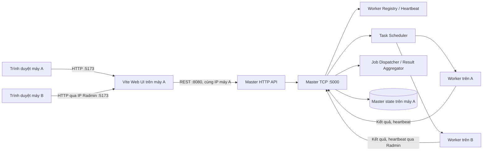

# Cấu trúc hệ thống

## Tổng quan

Radmin VPN cung cấp đường mạng riêng giữa A và B. Master luôn chạy trên A; B có thể mở cùng giao diện được A phục vụ và thao tác qua cùng API. Các trình duyệt đọc cùng một snapshot từ Master, nên trạng thái Worker, job và chính sách là trạng thái chung.

## Thành phần trong mã nguồn

| Thư mục / lớp | Trách nhiệm |
|---|---|
| `src/main/java/com/pbl4/app` | Điểm chạy Master/Worker, khởi chạy cụm và supervisor tự khởi động lại tiến trình. |
| `src/main/java/com/pbl4/master` | Registry, snapshot, lập lịch, điều phối job, lưu trạng thái Master. |
| `src/main/java/com/pbl4/master/http` | REST API cho giao diện web và các thao tác worker/job. |
| `src/main/java/com/pbl4/worker` | Worker TCP, đăng ký, heartbeat, nhận lệnh và chạy phép tính. |
| `src/main/java/com/pbl4/core` | Mô hình thông điệp, dữ liệu job và tiện ích truyền TCP/JSON. Giao thức hiện tại là v4. |
| `src/main/java/com/pbl4/computing` | Phép tính ma trận, đồ thị, chia phần việc và ghép kết quả. |
| `frontend/src` | Giao diện React; lấy dữ liệu từ Master API, không tự tạo danh sách worker giả. |
| `scripts` | Script build/demo, chạy Master/Worker, chẩn đoán và chạy UI trên mạng. |
| `src/test/java` | Kiểm thử đơn vị, giao thức, phục hồi, tính toán và tích hợp mạng/API. |

## Danh tính và gộp Worker

- `workerId` là ID duy nhất để Master định tuyến lệnh. Mỗi Worker trong cụm cần ID khác nhau.
- `machineId` gom các Worker thuộc cùng một laptop; máy A và B cần giá trị khác nhau.
- `displayName` là bí danh chỉnh được trong giao diện. Đổi bí danh không thay ID, không làm gộp hay mất Worker.
- Snapshot `/api/cluster` trả danh sách worker và danh sách máy. Master tính tổng từ toàn bộ Worker đã đăng ký, nên tổng là số Worker A cộng số Worker B.
- Tên hiển thị có thể trùng; định danh và điều khiển vẫn dựa trên `workerId`.

## Điều khiển Worker và job

Giao diện có thể đổi chính sách lập lịch, gửi/hủy job và tạm dừng/bật lại từng Worker đang online. Khi tạm dừng, Worker vẫn gửi heartbeat và vẫn hiện trong cụm, nhưng không nhận tác vụ mới; việc đang chạy có thể hoàn thành. Worker OFFLINE không thể nhận lệnh bật/tạm dừng cho đến khi đăng ký lại.

Master là dịch vụ điều phối trung tâm và phải được chạy trên A. Giao diện hiện không dừng hoặc chuyển tiến trình Master sang máy khác; nếu Master dừng, API và việc lập lịch dừng theo.

## Luồng một phép tính

1. Trình duyệt gửi yêu cầu đến REST API trên A.
2. Master tạo job, chia thành task, chọn Worker đang đủ điều kiện theo chính sách và giới hạn tài nguyên.
3. Master gửi task qua TCP tới từng Worker; Worker trả tiến độ/kết quả và tiếp tục heartbeat.
4. Master xác nhận kết quả, ghép thành kết quả job và cập nhật trạng thái.
5. Các trình duyệt đọc snapshot/tiến độ từ cùng API; làm mới định kỳ để thấy thay đổi từ người dùng khác.

Job bất đồng bộ được lưu trong thư mục dữ liệu của Master (mặc định `data/master-<cổng>`). Dữ liệu đó cần nằm trên A và được giữ lại khi cập nhật ứng dụng. Đây không phải cơ chế dự phòng Master sang B.

## Mạng và an toàn

Các cổng mặc định trong cấu hình LAN: Master TCP `5000`, REST API `8080`, Vite UI `5173`; mỗi Worker cần một cổng TCP riêng (ví dụ `5101–5103`). Worker cần kết nối đến Master, và Master cần kết nối ngược đến cổng Worker để kiểm tra phiên, gửi việc và tạm dừng.

Ứng dụng chưa có tài khoản, phân quyền người dùng hoặc TLS. CORS chỉ chấp nhận trang web cùng hostname với API; đây không thay thế xác thực mạng. Hạn chế firewall theo IP A/B trên Radmin và chỉ dùng với người tin cậy.
